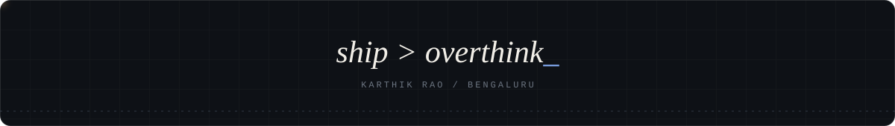

<div align="center">



<br/>

<a href="#about">about</a> &nbsp;·&nbsp; <a href="#work">work</a> &nbsp;·&nbsp; <a href="#stack">stack</a> &nbsp;·&nbsp; <a href="#open-source">open source</a> &nbsp;·&nbsp; <a href="#contact">contact</a>

</div>

<br/>

<a id="about"></a>
<picture>
  <source media="(prefers-color-scheme: dark)" srcset="./assets/sections/01-about-dark.svg">
  
</picture>

I like building the backend side of things, the APIs and the data and all the parts nobody sees but everything depends on. And then I take it all the way to the screen, because a feature isn't really done until someone can actually use it. Mostly C# and Java, with React on the front.

```http
GET /karthik

200 OK
location   Bengaluru, India
focus      backend systems, APIs, data models
stack      C#, ASP.NET Core, Java, Spring Boot, React
building   Snapory
learning   .NET internals, system design
open to    open source, good first issues
```

<br/>

<a id="work"></a>
<picture>
  <source media="(prefers-color-scheme: dark)" srcset="./assets/sections/02-work-dark.svg">
  
</picture>

**`01` &nbsp;[Snapory](https://github.com/karthikurao/snapory)** &nbsp;·&nbsp; *what I'm building now*
<br/>The core flows across frontend and backend, with the code kept easy enough for a new contributor to jump in.

**`02` &nbsp;[LinkShield AI](https://github.com/karthikurao/linkshield-ai)** &nbsp;·&nbsp; `JavaScript`
<br/>Checks a URL in real time and flags malicious links and phishing attempts using machine learning.

**`03` &nbsp;[Moodify](https://github.com/karthikurao/Moodify)** &nbsp;·&nbsp; `Python`
<br/>Reads your mood from a live camera feed and picks a Spotify playlist to match.

**`04` &nbsp;[Voyara](https://github.com/karthikurao/Voyara)** &nbsp;·&nbsp; `JavaScript`
<br/>Give it a destination, a vibe and a number of days, and it plans the trip for you.

**`05` &nbsp;[CareCrew](https://github.com/karthikurao/CareCrew)** &nbsp;·&nbsp; `Java` &nbsp;·&nbsp; `Android`
<br/>Connects volunteers with community needs as they come up, like flood relief and blood donation.

**`06` &nbsp;[Deepfake Detection](https://github.com/karthikurao/Deepfake-Detection)** &nbsp;·&nbsp; `Python`
<br/>Tells you whether a video is real or AI-generated, using a ResNeXt CNN on the frames and an LSTM across them.

<br/>

<a id="stack"></a>
<picture>
  <source media="(prefers-color-scheme: dark)" srcset="./assets/sections/03-stack-dark.svg">
  
</picture>

<table>
  <tr><td><b>languages</b></td><td><code>C#</code> <code>Java</code> <code>JavaScript</code> <code>TypeScript</code> <code>Python</code></td></tr>
  <tr><td><b>backend</b></td><td><code>ASP.NET Core</code> <code>Spring Boot</code> <code>REST APIs</code> <code>Kafka</code></td></tr>
  <tr><td><b>frontend</b></td><td><code>React</code></td></tr>
  <tr><td><b>data</b></td><td><code>Cosmos DB</code> <code>Supabase</code></td></tr>
  <tr><td><b>ml</b></td><td><code>TensorFlow</code></td></tr>
  <tr><td><b>tools</b></td><td><code>Docker</code> <code>Git</code> <code>Ubuntu</code></td></tr>
</table>

<br/>

<a id="open-source"></a>
<picture>
  <source media="(prefers-color-scheme: dark)" srcset="./assets/sections/04-open-source-dark.svg">
  
</picture>

I want to get better by working on other people's code. If you maintain something backend or devtool flavoured and you have good first issues sitting around, I'm happy to help with bug fixes, API work, performance cleanups or docs.

<br/>

<a id="contact"></a>
<picture>
  <source media="(prefers-color-scheme: dark)" srcset="./assets/sections/05-contact-dark.svg">
  
</picture>

<table>
  <tr><td><b>web</b></td><td><a href="https://karthikrao.me">karthikrao.me</a></td></tr>
  <tr><td><b>linkedin</b></td><td><a href="https://www.linkedin.com/in/karthik-u-rao">in/karthik-u-rao</a></td></tr>
  <tr><td><b>x</b></td><td><a href="https://x.com/igotkarthik">@igotkarthik</a></td></tr>
  <tr><td><b>email</b></td><td><a href="mailto:karthikrao672@gmail.com">karthikrao672@gmail.com</a></td></tr>
  <tr><td><b>support</b></td><td><a href="https://www.buymeacoffee.com/igotkarthik">Buy Me a Coffee</a> &nbsp;·&nbsp; <a href="https://ko-fi.com/igotkarthik">Ko-fi</a></td></tr>
</table>

<br/>

 overthink" width="100%"/>
